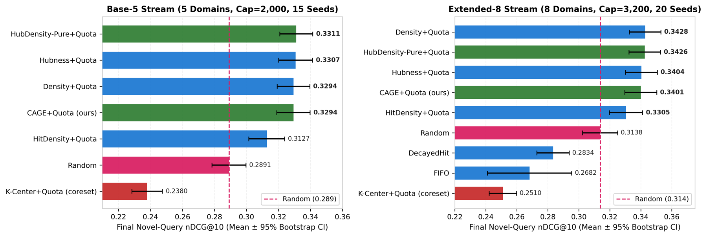

# ContinualRAG-BEIR: Bounded-Memory Eviction in Retrieval-Augmented Agents Under Sequential Domain Shift

[](paper.pdf)
[](LICENSE)
[](https://www.python.org/downloads/)

Code and results for **ContinualRAG-BEIR**, a leak-free benchmark for non-parametric, bounded-memory document eviction in RAG systems under sequential domain shift, and **CAGE** (*Centrality-Anchored Gated Eviction*), a dual-memory policy that combines a multi-hit admission gate with a domain-stratified structural-centrality core.

> **Status.** `paper.pdf` and `results/` hold the numbers reported in the paper. The `continual_rag/` package is a clean, tested re-implementation of the protocol and policies; the end-to-end run on real BEIR data (`scripts/run_benchmark.py`) is what you use to regenerate those numbers.

## Problem and findings (as reported in the paper)

A RAG index has a fixed budget (M_max = 40% of streamed passages) and domains arrive sequentially. Which passages should it keep, balancing **repeated Zipfian traffic** (exploitation) against **unseen novel queries** (exploration)?

1. **Reuse bottleneck.** Only 6.5% of test-relevant documents are ever relevant to a usage query; "relevant to a usage query" has ROC-AUC 0.396 (< 0.5) for novel-query relevance. Frequency/recency policies (LRU, LFU, DecayedHit, WindowHit) gain on repeated traffic but do not beat `Random` on novel queries.
2. **Coreset paradox.** `K-Center` / `K-Center+Quota` fall 0.041–0.063 nDCG@10 *below* `Random`: farthest-point traversal picks geometric anti-hubs (outlierness AUC 0.401).
3. **Structural centrality.** Training-free within-domain density/hubness with per-domain quotas (`Density+Quota`, `Hubness+Quota`, `HubDensity-Pure+Quota`) beats `Random` by 0.027–0.042 nDCG@10, including under the E5 → BGE cross-embedder control.
4. **CAGE+Quota.** Reserves at most ρ = 6% of each domain quota for docs passing a multi-hit gate (h ≥ 1.2, ranked by hit-rate × centrality) and fills the other 94% with composite hub-density-medoid documents. The paper reports it beats `Random` on novel queries, beats `Density+Quota` on repeated queries, and stays within a 0.01-nDCG non-inferiority margin of pure structural eviction on novel queries.



## Confirmatory results (locked seeds)

Generated from [`results/confirmatory_master.csv`](results/confirmatory_master.csv). Bold = best in column.

**Base-5, same embedder (BGE → BGE), 15 seeds (600–614), cap 2,000**

| Strategy | Novel nDCG@10 | Repeated nDCG@10 | Rep. + Cache | Mixed (r=0.25) | Mixed (r=0.50) | BWT | ms/doc |
| :--- | :---: | :---: | :---: | :---: | :---: | :---: | :---: |
| `CAGE+Quota` (ours) | 0.3130 | 0.4401 | 0.4766 | 0.3447 | 0.3765 | -0.2123 | 0.0327 |
| `HitDensity+Quota` | 0.3038 | **0.4723** | 0.4525 | **0.3459** | **0.3881** | -0.1946 | 0.0159 |
| `Hubness+Quota` | **0.3199** | 0.3205 | 0.4671 | 0.3201 | 0.3202 | -0.2027 | 0.0238 |
| `Density+Quota` | 0.3157 | 0.3244 | 0.4703 | 0.3179 | 0.3201 | -0.2149 | 0.0164 |
| `HubDensity-Pure+Quota` | 0.3156 | 0.3146 | 0.4773 | 0.3154 | 0.3151 | -0.2086 | 0.0321 |
| `Random` | 0.2891 | 0.2958 | **0.4875** | 0.2908 | 0.2925 | -0.2785 | 0.0003 |
| `K-Center+Quota (stratified coreset)` | 0.2483 | 0.2465 | 0.4196 | 0.2478 | 0.2474 | -0.2314 | 0.0744 |

**Base-5, cross-embedder control (E5 → BGE), 15 seeds (600–614), cap 2,000**

| Strategy | Novel nDCG@10 | Repeated nDCG@10 | Rep. + Cache | Mixed (r=0.25) | Mixed (r=0.50) | BWT | ms/doc |
| :--- | :---: | :---: | :---: | :---: | :---: | :---: | :---: |
| `CAGE+Quota` (ours) | 0.3294 | 0.4504 | 0.4853 | **0.3597** | 0.3899 | -0.2027 | 0.0327 |
| `HitDensity+Quota` | 0.3127 | **0.4860** | 0.4642 | 0.3560 | **0.3993** | -0.1915 | 0.0163 |
| `HubDensity-Pure+Quota` | **0.3311** | 0.3334 | 0.4860 | 0.3317 | 0.3322 | -0.2008 | 0.0323 |
| `Hubness+Quota` | 0.3307 | 0.3365 | 0.4871 | 0.3322 | 0.3336 | -0.1933 | 0.0232 |
| `Density+Quota` | 0.3294 | 0.3304 | 0.4835 | 0.3297 | 0.3299 | -0.2038 | 0.0174 |
| `Random` | 0.2891 | 0.2958 | **0.4875** | 0.2908 | 0.2925 | -0.2785 | 0.0002 |
| `K-Center+Quota (stratified coreset)` | 0.2380 | 0.2445 | 0.4034 | 0.2396 | 0.2412 | -0.2418 | 0.0730 |

**Extended-8 stream (E5 → BGE), 20 seeds (700–719), 8,000 docs, cap 3,200**

| Strategy | Novel nDCG@10 | Repeated nDCG@10 | Rep. + Cache | Mixed (r=0.25) | Mixed (r=0.50) | BWT | ms/doc |
| :--- | :---: | :---: | :---: | :---: | :---: | :---: | :---: |
| `CAGE+Quota` (ours) | 0.3401 | 0.4732 | 0.5245 | 0.3734 | 0.4067 | -0.2135 | 0.0457 |
| `HitDensity+Quota` | 0.3305 | 0.5230 | 0.5005 | **0.3787** | 0.4268 | -0.1975 | 0.0216 |
| `Density+Quota` | **0.3428** | 0.3589 | 0.5299 | 0.3469 | 0.3509 | -0.2177 | 0.0244 |
| `HubDensity-Pure+Quota` | 0.3426 | 0.3533 | 0.5243 | 0.3453 | 0.3480 | -0.2106 | 0.0451 |
| `Hubness+Quota` | 0.3404 | 0.3497 | 0.5175 | 0.3428 | 0.3451 | -0.2018 | 0.0335 |
| `DecayedHit` | 0.2834 | **0.5911** | 0.5511 | 0.3603 | **0.4373** | -0.3192 | 0.0003 |
| `Random` | 0.3138 | 0.3283 | **0.5684** | 0.3174 | 0.3211 | -0.2952 | 0.0002 |
| `K-Center+Quota (stratified coreset)` | 0.2510 | 0.2500 | 0.4491 | 0.2507 | 0.2505 | -0.2380 | 0.1123 |

Figures: [`assets/`](assets/). Pre-eviction audit (paper Table 1): [`results/audit.csv`](results/audit.csv).

## Install

```bash
git clone https://github.com/blck-iris/ContinualRAG-BEIR.git
cd ContinualRAG-BEIR
pip install -e ".[dev]"          # core + tests
pip install -e ".[embed]"        # + torch / sentence-transformers, only for real BEIR runs
pytest                           # fast synthetic-data tests, no downloads
```

## Reproduce the paper's regimes (real BEIR data)

```bash
python scripts/run_benchmark.py --regime base5-same     # BGE -> BGE, seeds 600-614
python scripts/run_benchmark.py --regime base5-cross    # E5  -> BGE, seeds 600-614
python scripts/run_benchmark.py --regime ext8           # 8 domains, E5 -> BGE, seeds 700-719
```

BEIR zips download from the UKP server on first use; embeddings are cached in `./cache`. A GPU is strongly recommended for embedding. Each run writes `per_seed.csv`, `summary_table.csv`, and prints the pre-declared hypothesis tests (H_a, H_b, H_c, H_d, H_k; Holm-corrected Wilcoxon).

## Add your own policy

```python
from continual_rag import Config, run_suite, register_policy
from continual_rag.policies.base import ScorePolicy
from continual_rag.policies.structural import knn_density, knn_indegree

# score_fn(E, Q, w): E (n, d) candidate embeddings, Q (m, d) served queries, w (m,) decayed service counts
def my_score(E, Q, w):
    return knn_density(E, k=5) + 0.5 * (knn_indegree(E, k=10) / len(E))

register_policy("MyPolicy+Quota")(
    lambda ep, cap, fb, seed: ScorePolicy(ep, cap, fb, seed, my_score, per_domain=True, quota=True))

# df = run_suite(cfg, pools, range(600, 615), ["Random", "MyPolicy+Quota"])
```

For stateful policies subclass `continual_rag.policies.base.Policy` and implement `select(cand, t)`.

## Repository layout

```text
continual_rag/
  config.py      Config, domain sets, embedder presets
  data.py        BEIR loader / embedder / pools (+ synthetic pools for tests)
  episode.py     leak-free usage/test split, Zipf stream, exact retrieval
  runner.py      run_episode / run_suite -> metrics per seed
  metrics.py     nDCG, BWT, forgetting, bootstrap CI, paired Wilcoxon, Holm
  audit.py       pre-eviction predictability audit (Table 1)
  report.py      hypothesis verdicts and summary tables
  policies/      base (registry), classic, structural, cage
scripts/run_benchmark.py     CLI for the three confirmatory regimes
notebooks/quickstart_synthetic.ipynb   API demo on synthetic data (plumbing only)
results/  assets/  paper.pdf  tests/
```

## Scope (from the paper)

Frozen encoders (BGE-small, E5-small); each domain subsampled to 1,000 documents; stationary per-domain Zipf (s = 1.0) usage stream; binary relevance feedback as the primary setting.

## Citation

```bibtex
@article{bethala2026continualrag,
  title  = {ContinualRAG-BEIR: Benchmarking and Diagnosing Bounded-Memory Eviction in Retrieval-Augmented Agents Under Sequential Domain Shift},
  author = {Bethala, Samuel Raju},
  year   = {2026},
  url    = {https://github.com/blck-iris/ContinualRAG-BEIR}
}
```
